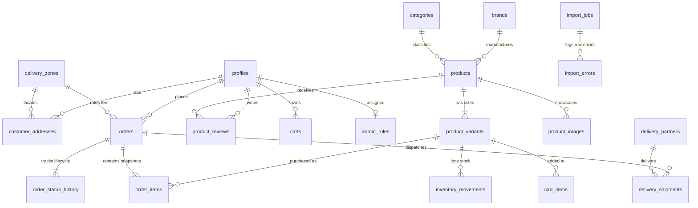

# Lashker Traders — Database Architecture & Entity Relationships

This document details the normalized relational PostgreSQL schema for **Lashker Traders**, designed for high-concurrency diaper e-commerce in Bangladesh.

## 1. Entity Overview

The schema is divided into 20 core entities:

1. **`profiles`**: User identity linked to Supabase Auth (`auth.users.id`). Stores roles (`super_admin`, `admin`, `manager`, `staff`, `customer`).
2. **`categories`**: Product taxonomy (e.g., Baby Diapers (Belt), Diaper Pants, Baby Wipes).
3. **`brands`**: Diaper manufacturers (e.g., Twinkle, Huggies, Pampers, Molfix, NeoCare).
4. **`products`**: Master catalog entities with SEO metadata, tags, and descriptions.
5. **`product_variants`**: Concrete purchasable items. **Diaper sizes (`S`, `M`, `L`, `XL`, `XXL`, `XXXL`) and pack counts (`42`, `40`, `34`, `32`, `24`, `24`)** are modeled as real database rows, each with distinct SKU, price, regular price, stock quantity, and availability.
6. **`product_images`**: Responsive images uploaded to Supabase Storage.
7. **`inventory_movements`**: Auditable ledger tracking all stock increments/decrements (order reservation, fulfillment, cancellation, restock, manual adjustment, bulk import).
8. **`carts` & `cart_items`**: Persistent carts for authenticated users and session syncing.
9. **`orders`**: Sequential public order numbering (`LT-00001` upwards), high-entropy guest tracking tokens, financial totals stored in exact decimal (`NUMERIC(10,2)`).
10. **`order_items`**: Immutable historical snapshots of product name, variant size, pack count, SKU, and unit price at time of purchase.
11. **`order_status_history`**: Audit trail of every lifecycle transition with actor and timestamp.
12. **`customer_addresses`**: Saved delivery addresses per customer profile.
13. **`product_reviews`**: 1-to-5 star ratings, customer feedback, verified purchase badges, and staff moderation status.
14. **`delivery_zones`**: Database-backed regional delivery rules (Inside Dhaka ৳60, Suburban Dhaka ৳80, Outside Dhaka ৳120).
15. **`delivery_partners`**: Courier integrations (Pathao, Steadfast, In-house).
16. **`delivery_shipments`**: Tracking numbers, consignment IDs, shipping costs, and webhook payloads.
17. **`admin_roles`**: Granular role-based permissions matrix for staff members.
18. **`import_jobs` & `import_errors`**: CSV/XLSX product import audit logs, row-level validation reports, and progress tracking.
19. **`store_settings`**: Key-value JSONB settings for branding, WhatsApp contact (`01797753722`), and pricing thresholds.
20. **`audit_logs`**: System audit trail capturing sensitive administrative actions, IP addresses, and before/after payloads.

---

## 2. Entity Relationship Diagram (ERD)

---

## 3. Financial and Inventory Integrity Rules

1. **Exact Decimal Representation**: All money is stored as `NUMERIC(10,2)` with check constraints `CHECK (price >= 0)`. Floating-point math is strictly forbidden.
2. **Order-time Frozen Snapshots**: When an order is placed, `product_name_snapshot`, `variant_size_snapshot`, `pack_count_snapshot`, `sku_snapshot`, and `unit_price` are copied to `order_items`. Modifying the product catalog never alters existing order histories.
3. **Concurrency-Safe Sequential Order Numbering**:
   - PostgreSQL Sequence: `order_public_seq`
   - Atomic generation formatted as `LT-00001`, `LT-00002`...
   - Enforced by a database-level `UNIQUE` constraint.
4. **Idempotency Keys**: Duplicate browser requests or retries with the same `idempotency_key` return the existing order without creating duplicates or decrementing stock twice.
5. **Stock Lock**: The `place_lashker_order` stored procedure uses `SELECT ... FOR UPDATE` to atomically check availability and prevent overselling.
